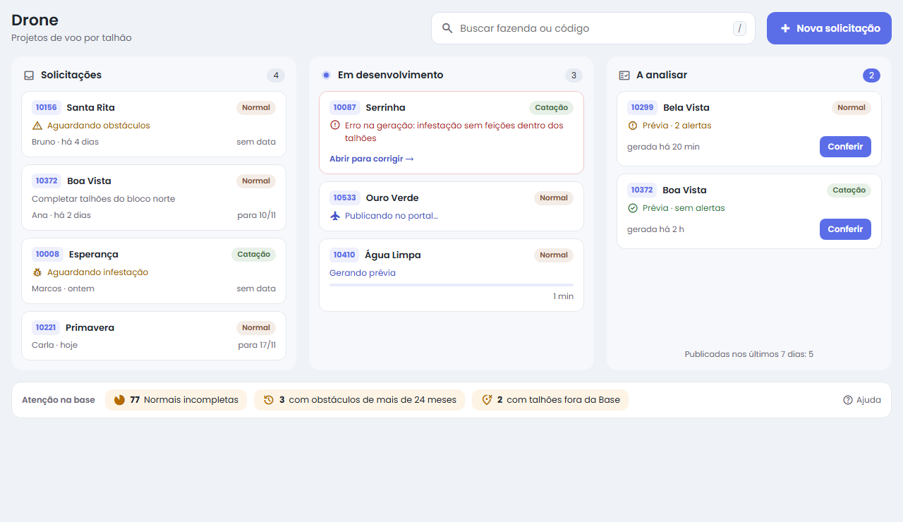
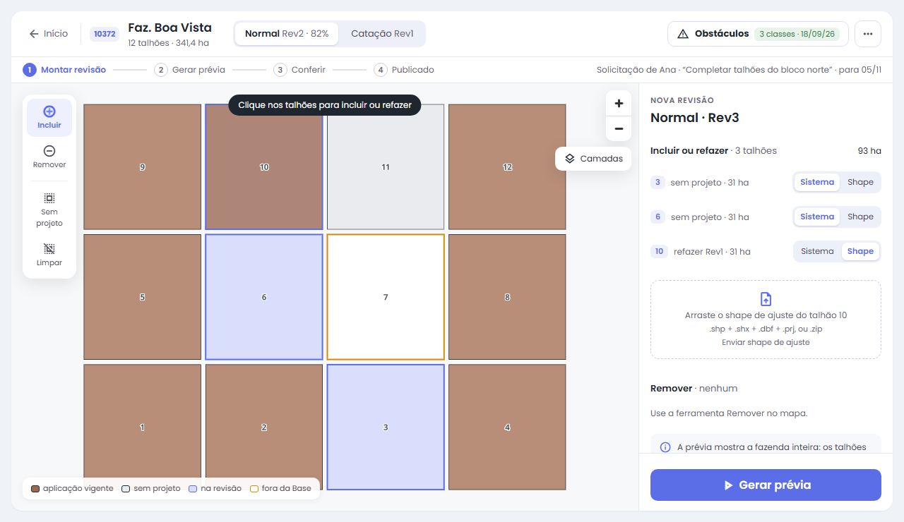
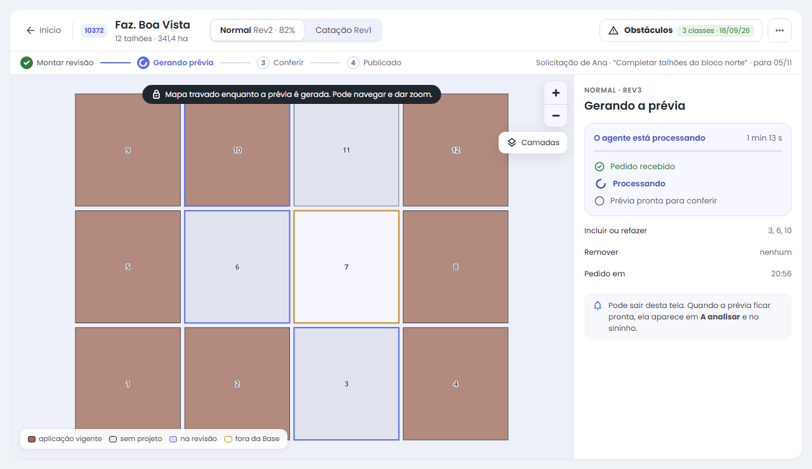
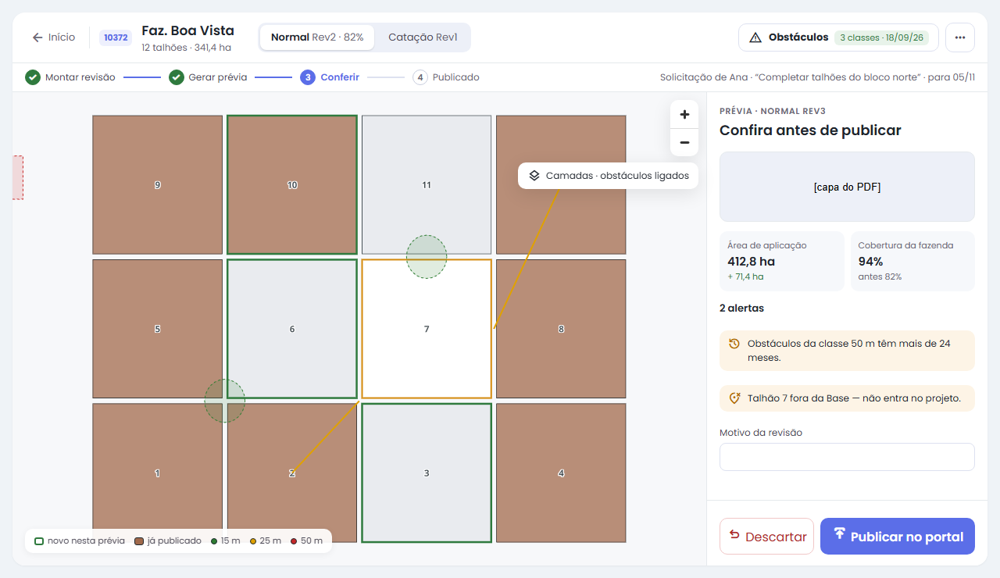
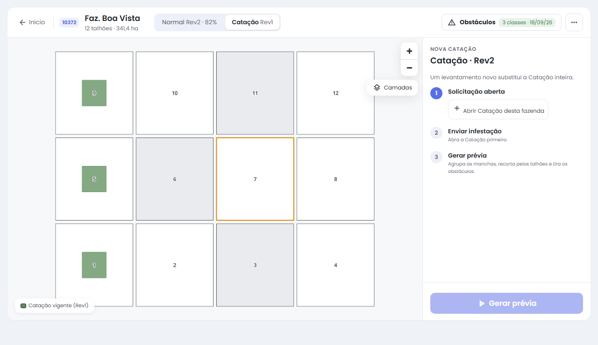
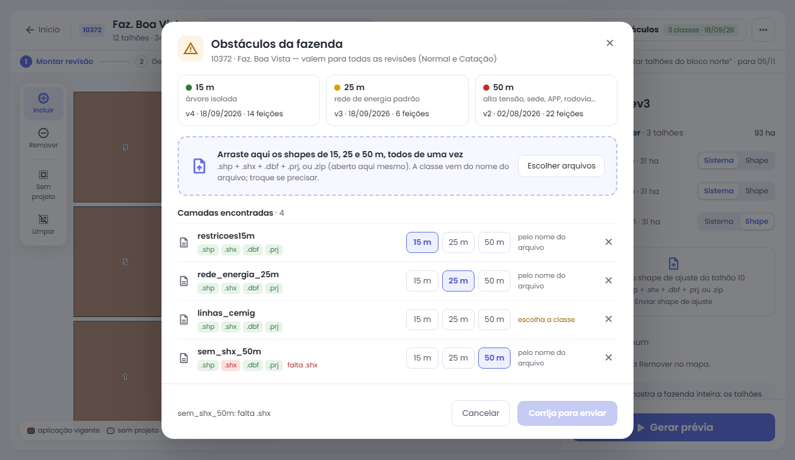

# Drone no Hub: guia rápido

A tela **Drone** do Hub é onde a Geo faz os projetos de aplicação por drone. Os projetos publicados vão para o portal de downloads, na aba Drone, e é de lá que os pilotos baixam.

## Os dois tipos de projeto

- **Normal:** aplicação na fazenda inteira. É o talhão menos os obstáculos (árvores 15 m, rede 25 m, demais 50 m). O projeto é montado **talhão a talhão**: dá para completar, refazer ou tirar talhões sem mexer no resto.
- **Catação:** só as manchas de infestação de um levantamento. Manchas a até 20 m viram um bloco, com 5 m de folga. Cada levantamento novo **substitui a Catação inteira**.

## Início

- **Três colunas**, da esquerda para a direita:
  - **Solicitações:** pedidos abertos, esperando geração, obstáculos ou infestação;
  - **Em desenvolvimento:** o que o agente está gerando ou publicando agora, com o tempo decorrido. O ponto ao lado do título pulsa enquanto algo anda;
  - **A analisar:** prévias prontas, com o número de alertas e o botão **Conferir**. No fim da coluna aparece quantas foram publicadas nos últimos 7 dias.
- Clique num cartão (ou use Tab e Enter/Espaço) para abrir a fazenda. Quando um pedido muda de etapa, o cartão desliza para a coluna nova. A tela se atualiza sozinha enquanto há algo andando.
- **Atenção na base** (faixa de baixo): Normais incompletas, obstáculos com mais de 24 meses e talhões fora da Base. Clique num botão para abrir a lista na lateral; clique numa fazenda da lista para abri-la.
- **Busca:** digite o nome ou o código da fazenda. **/** vai direto para a busca e **Esc** limpa.

## A fazenda aberta

- **Cabeçalho:** **← Início** volta ao Início. As abas **Normal** e **Catação** mostram a revisão vigente (e, na Normal, quanto da fazenda está coberto). O botão **Obstáculos** traz a situação das três classes (verde: em dia; amarelo: antigo ou sem cadastro; vermelho: erro no último envio; azul: processando). O menu **⋯** tem **Revisões** (o histórico) e **Cancelar solicitação**.
- **Etapas:** Montar revisão → Gerar prévia → Conferir → Publicado. A barra mostra onde a revisão está.
- **Ferramentas do mapa** (à esquerda): **Incluir**, **Remover**, **Sem projeto** (marca de uma vez os talhões que faltam) e **Limpar**.
- **Camadas** (à direita do mapa): liga os obstáculos, com o buffer de cada classe.
- **Legenda** (embaixo): o significado das cores muda com a etapa e está sempre na legenda. Montando: marrom é a aplicação vigente, cinza é sem projeto, azul é o que entra na revisão e o contorno laranja marca talhão fora da Base.
- **Painel da direita:** mostra só o que importa na etapa em que a revisão está: montar, gerar, conferir, publicar ou corrigir um erro.

## Pedir um projeto (solicitante)

1. No Início, clique em **Nova solicitação**.
2. Escolha a fazenda e, se quiser, a data desejada e uma observação.
3. A Geo recebe o aviso no sininho. Quando o projeto for publicado, todos com o módulo Drone recebem o aviso "Publicado".

## Completar ou refazer uma Normal (Geo)

1. Abra a fazenda por um cartão do Início, pela busca ou pelo sininho, na aba **Normal**.
2. Com **Incluir**, clique nos talhões que vão entrar ou ser refeitos. **Sem projeto** marca de uma vez os que faltam.
3. No painel, escolha a fonte de **cada talhão**:
   - **Sistema:** usa o talhão da Base menos os obstáculos;
   - **Shape:** usa um shape de ajuste feito no QGIS. Arraste os arquivos na área que aparece no painel (`.shp` + `.shx` + `.dbf` + `.prj`, ou um `.zip`).
4. Para tirar talhões, use **Remover** e clique neles.
5. Clique em **Gerar prévia**. O mapa mostra a varredura e os talhões em geração pulsam; o painel mostra recebido → processando → pronta.

6. Na prévia, clique na capa para abrir o PDF. Confira a área, a cobertura e os alertas, escreva o **motivo** (obrigatório a partir da Rev1) e clique em **Publicar no portal**. Se algo estiver errado, clique em **Descartar** e monte de novo.

Na prévia, o contorno verde marca o que é novo nesta revisão. Os talhões que os obstáculos tomam por inteiro ficam fora do projeto, e a prévia avisa quais são.

## Catação (Geo)

1. Na fazenda, abra a aba **Catação**. Se ainda não houver uma solicitação, clique em **Abrir Catação desta fazenda**.
2. Arraste as camadas de infestação na área do painel (pode mandar várias de uma vez, ou um `.zip`). Para mandar outras depois, use **Trocar arquivos**.
3. Clique em **Gerar prévia**, confira e publique. Um levantamento novo substitui a Catação inteira.

## Obstáculos

1. Na fazenda, clique em **Obstáculos**. A janela mostra as três classes cadastradas (15, 25 e 50 m), com a versão, a data e o número de feições.
2. Arraste os shapes de todas as classes **de uma vez** (ou use **Escolher arquivos**). Um `.zip` é aberto ali mesmo.
3. Cada camada aparece numa linha. A classe vem do nome do arquivo (ex.: `restricoes15m.shp`); quando o nome não diz, escolha **15 m**, **25 m** ou **50 m**. Use **×** para tirar uma camada.
4. Cada camada precisa de `.shp`, `.shx`, `.dbf` e `.prj`; a linha avisa o que falta e o botão só libera quando tudo está certo.
5. Clique em **Enviar**. Ao terminar, a camada de obstáculos liga sozinha no mapa.

- Quem só tem leitura abre a janela para consultar, sem enviar.
- Um envio por vez: enquanto o anterior processa, a janela espera. Se ele ficar parado **mais de 2 h**, a janela avisa e libera um envio novo (o agente pode estar desligado; vale o mais novo).
- Obstáculo novo **não refaz** projeto publicado. Ele vale para as próximas gerações, e a prévia avisa quando há obstáculo mais novo do que o projeto.

## Avisos (sininho)

| Aviso | Quando some |
|---|---|
| Nova solicitação | ao gerar a prévia |
| Prévia pronta para conferir | ao publicar ou descartar |
| Erro na geração, no envio ou ao publicar | ao gerar ou enviar de novo |
| Publicado | depois de 7 dias |

## Consultas

Em **Consultas → Drone**, a tabela mostra, por fazenda: a Normal (revisão e cobertura), a Catação (revisão e área), as datas dos obstáculos e a solicitação aberta. Dá para filtrar, copiar para o Excel ou mandar a lista pelo WhatsApp.

## Quando algo dá errado

- **"Já existe uma prévia aberta":** publique ou descarte a prévia que está aberta antes de gerar outra.
- **"Talhões que não existem na Base de hoje":** o talhão saiu ou mudou de número na Base. Atualize a seleção.
- **Envio com erro:** a mensagem aparece na janela de Obstáculos (e o botão Obstáculos fica vermelho) ou no painel, junto do shape de ajuste ou da infestação. Corrija o arquivo e envie de novo.
- **Envio de obstáculos parado:** depois de 2 h a janela libera um envio novo. Se acontecer de novo, avise o responsável pelo servidor Geo.
- **Prévia que não sai do "gerando…" por vários minutos:** o agente do servidor Geo pode estar parado. Avise o responsável pelo servidor.
